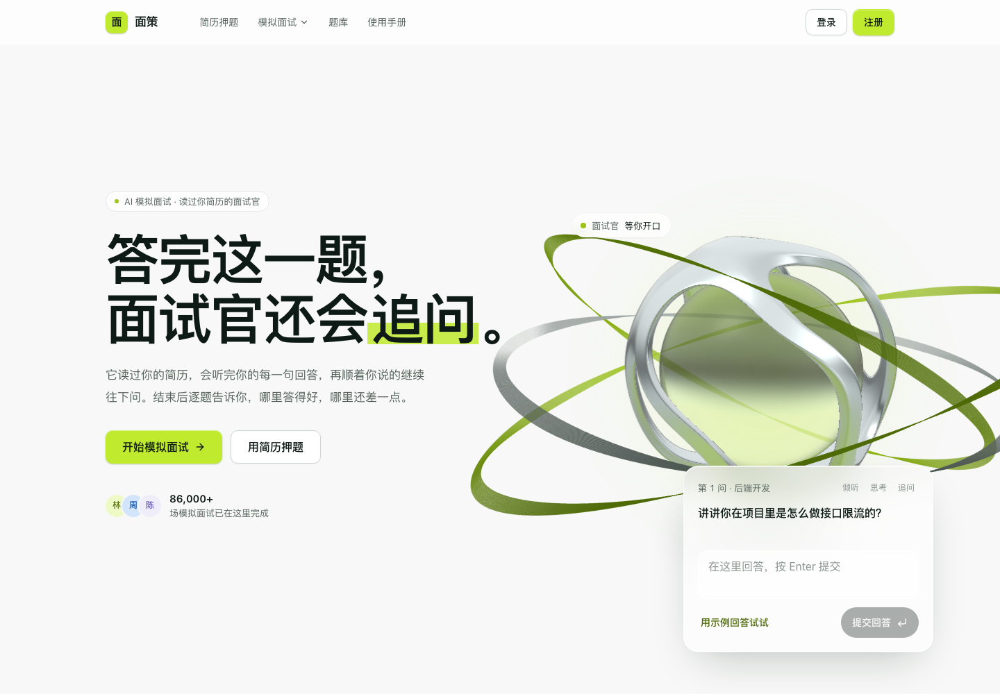
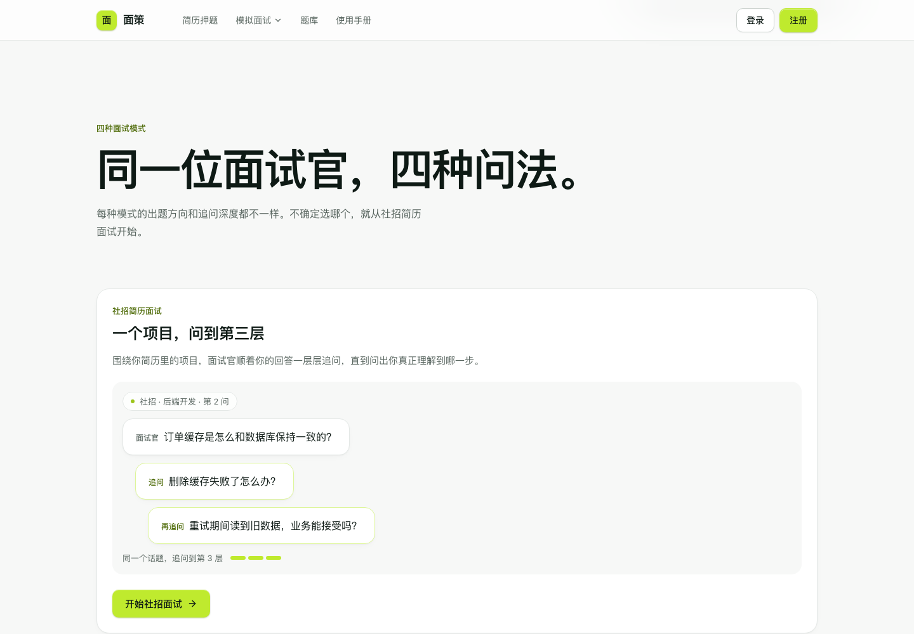
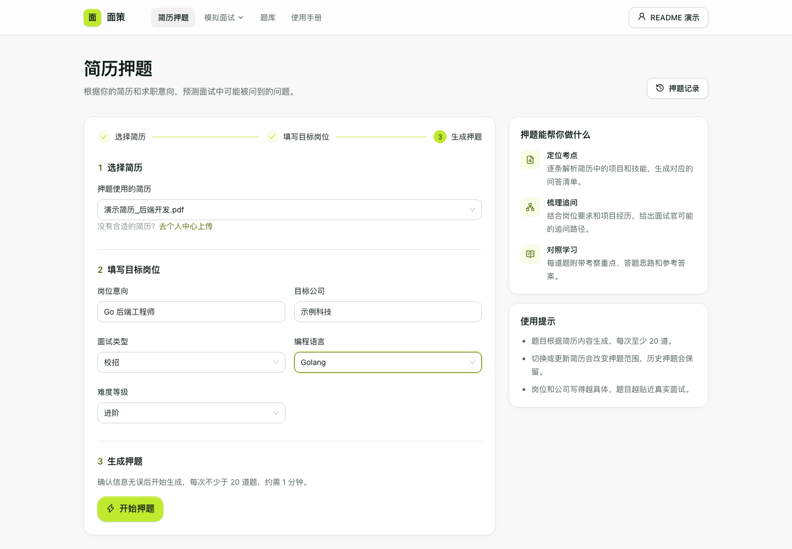
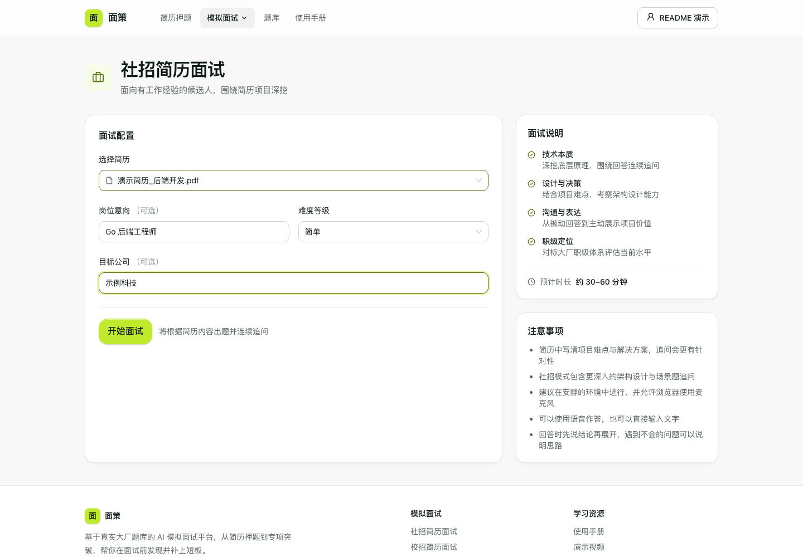
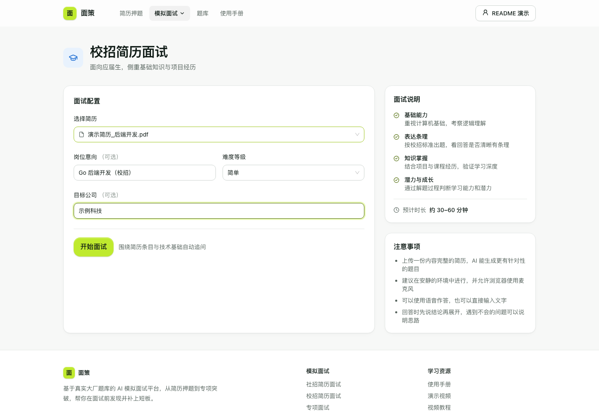
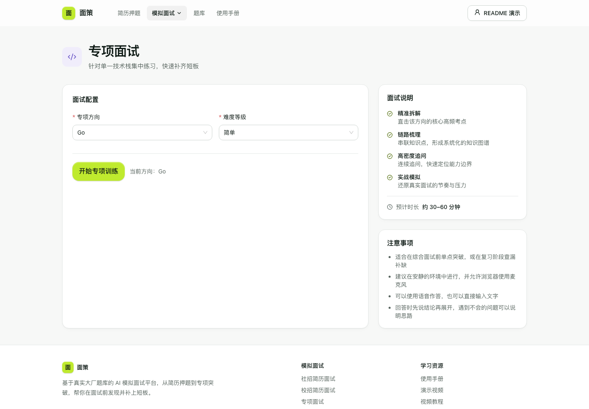
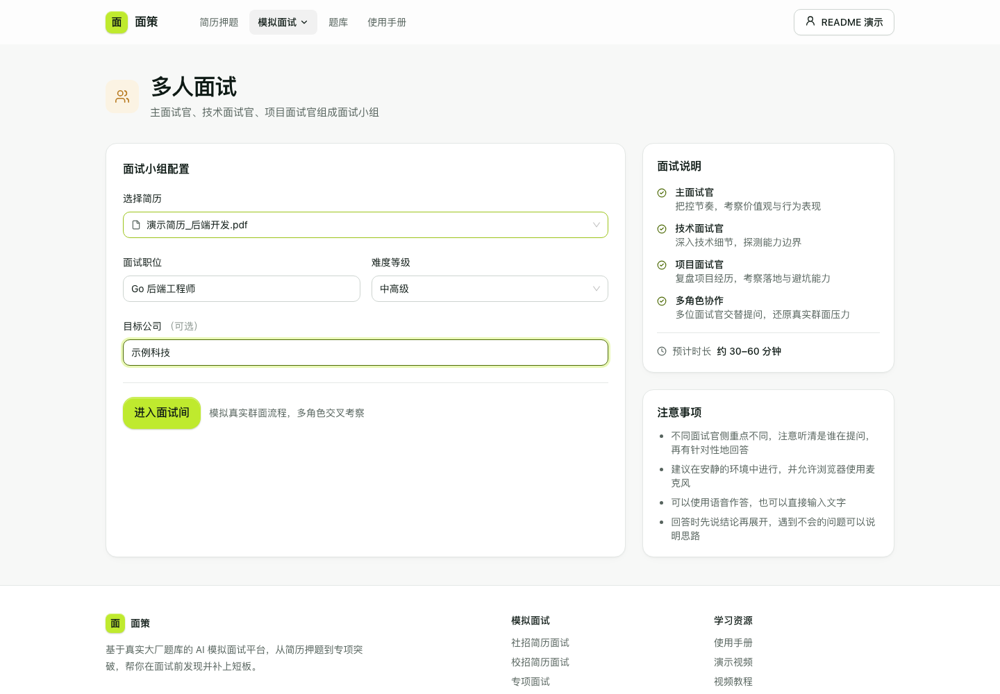
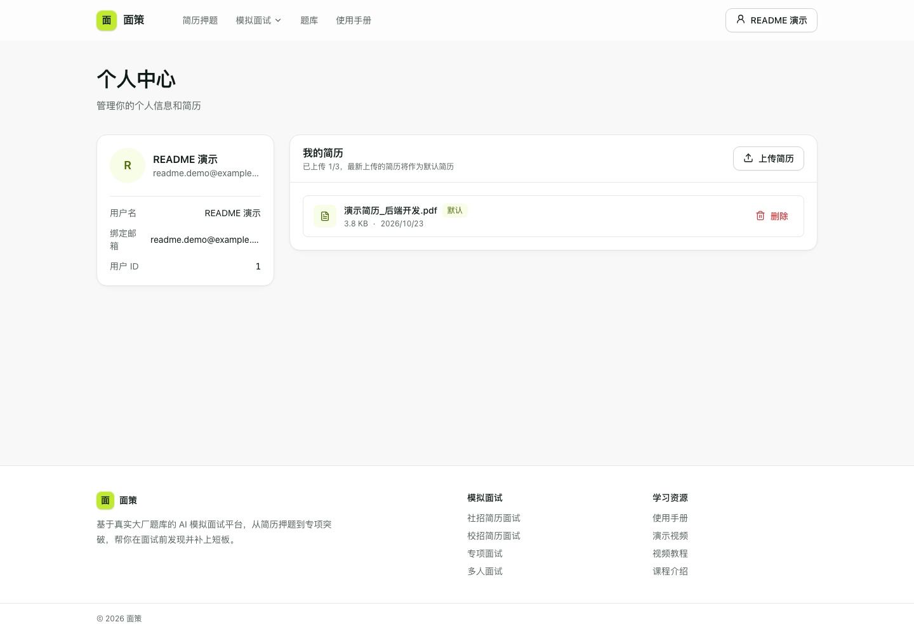
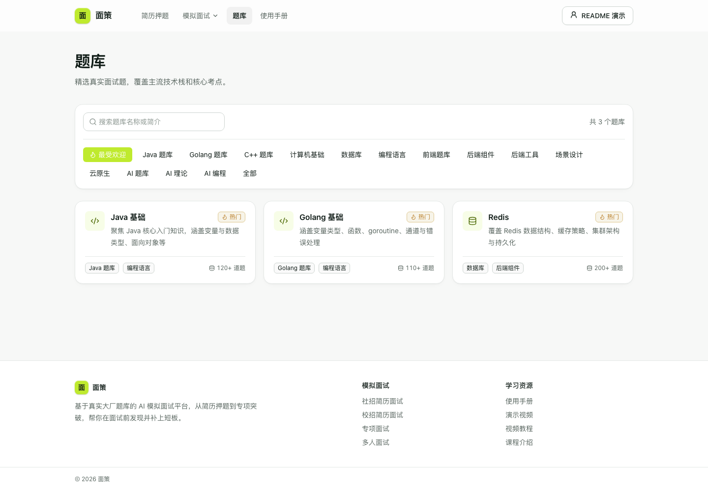

# 面策 · AI 模拟面试平台

**答完这一题，面试官还会追问。**

基于 Go、Hertz、Eino 和 Next.js 的 AI 面试练习平台。从简历押题到模拟面试，再到逐题点评与评估报告，帮助求职者发现知识盲区、练习项目表达。

```text
上传 PDF 简历 → 生成岗位押题 → 选择面试模式 → 文字 / 语音作答 → 查看评估与复盘
```



[本地运行](#本地运行) · [页面预览](#页面预览) · [技术栈](#技术栈) · [Docker 部署](#docker-部署) · [相关文档](#相关文档)

## 页面预览

以下截图于 **2026-10-23** 从本地运行的当前版本截取。需登录的页面使用独立本地数据库中的虚构演示账号与简历；首页交互、统计数字及反馈图表属于演示内容。

### 四种面试模式

首页以交互式首屏和章节介绍串联面试模式、简历押题、评估反馈与常见问题。首屏可输入回答体验追问；这段演示使用本地规则，不调用模型服务。



| 模式 | 使用场景 | 简历要求 |
| --- | --- | --- |
| 社招简历面试 | 围绕工作经历、项目难点与技术决策深入追问 | 需要 |
| 校招简历面试 | 结合计算机基础与项目经历练习表达 | 需要 |
| 专项面试 | 按技术方向与难度集中练习 | 无需简历 |
| 多人面试 | 主面试官、技术面试官、项目面试官协作提问 | 需要 |

### 简历押题



选择已上传简历，填写面试类型、编程语言、岗位、难度及目标公司，生成问题、考察重点、答题思路、参考答案和可能的追问。生成记录可在个人菜单的「押题记录」中查看。

### 社招简历面试

选择简历，按需填写目标岗位、公司和难度，围绕项目实现、设计决策与技术原理展开追问。



### 校招简历面试

侧重基础知识、表达条理与项目理解，适合应届生练习从知识点到项目经历的完整回答。



### 专项面试

选择技术方向与难度即可开始集中训练，适合考前突击和查漏补缺。



### 多人面试

由三类面试官从行为表现、技术细节与项目落地等角度交替提问，模拟面试小组的交叉考察。



面试间通过 SSE 接收问题，支持文字作答；配置 ASR 后可使用语音转写。结束后可在「面试记录」中查看各维度评分、总评与逐题点评。

### 个人中心



查看个人资料，上传和删除 PDF 简历，跟踪待解析、解析中、已完成或失败状态。社招、校招、多人面试与简历押题需要先准备简历。

### 题库浏览

按分类筛选和搜索题库卡片。当前列表使用前端示例数据，尚未接入完整题库服务。



## 当前功能范围

- 账号：邮箱注册与登录、JWT 鉴权；GitHub/Google OAuth 与找回密码需要对应服务配置。
- 简历：PDF 上传、异步解析与状态展示；Redis Stream 执行后台任务。
- 押题：基于简历和岗位配置生成问题，支持历史记录、详情与删除。
- 面试：四种训练模式、连续追问、SSE 流式输出和答题记录。
- 复盘：总分、各维度得分、总评、逐题点评和改进建议。
- 可选集成：ASR、PayPal/Stripe、Milvus/Embedding、LiteLLM、CozeLoop。

「我的笔记」目前使用本地示例数据。专项后端已实现 Go、Java、MySQL、Redis 和 MQ 面试官，页面中其他技术方向尚需与后端能力对齐。向量检索工具已集成，但服务入口默认未初始化 Milvus，知识库增强需要另外配置。

## 技术栈

| 层级 | 主要技术 |
| --- | --- |
| 前端 | Next.js 14.0.4、React 18.2、TypeScript、Tailwind CSS |
| 组件与交互 | Ant Design、Motion、Lucide、Zustand、TanStack Query、Axios |
| 后端 | Go 1.25.1、Hertz、GORM |
| AI 编排 | Eino ADK；OpenAI 兼容、Gemini、Ark 模型接入 |
| 数据与异步任务 | MySQL 8、Redis 7 / Redis Stream |
| 文档处理 | PDF 文本提取、Poppler；按需 OCR |
| 部署 | Docker Compose、Nginx |

```text
浏览器
  ├─ 本地开发：Next.js :3000 → /api 转发 → Hertz :8899
  └─ 容器部署：Nginx :81 → Next.js / Hertz
                                ├─ MySQL（业务记录）
                                ├─ Redis（缓存、限流、异步任务）
                                └─ LLM（简历解析、押题、面试与评估）
```

## 本地运行

### 环境准备

- Go 1.25.1（与 `go.mod` 一致，本次已验证可启动）
- Node.js 与 npm（项目 Dockerfile 使用 Node 18）
- Docker Compose，用于启动 MySQL 和 Redis
- Poppler（提供 `pdftotext`、`pdfinfo`）；使用扫描件 OCR 时另装 Tesseract
- 可用的大模型接口及 API Key，用于简历解析、押题、面试与评估

当前 Sonic 依赖在本机 Go 1.27.2 下编译失败。下面通过 `GOTOOLCHAIN=go1.25.1` 指定已验证的工具链。

### 仅预览前端

在项目根目录执行：

```bash
npm ci --prefix frontend
npm run dev
```

打开 [http://localhost:3000](http://localhost:3000) 即可查看首页、题库与专项配置。登录、简历管理和真实 AI 面试需要继续启动后端与依赖。

### 1. 配置

首次使用时克隆仓库并创建配置；已有仓库可跳过克隆，已有配置可直接检查并补充：

```bash
git clone https://gitee.com/tao355667/ai-interview-platform.git
cd ai-interview-platform
cp .env.example .env
cp .env.example backend/.env
```

根目录 `.env` 供 Docker Compose 使用。后端启动时读取当前工作目录的 `.env`，因此下面从 `backend/` 运行时使用 `backend/.env`。

在 `backend/.env` 中填写 `LLM_API_KEY`、`LLM_BASE_URL`、`LLM_MODEL_NAME`、`LLM_PROVIDER_NAME`。协议支持 `OpenAI`、`Gemini` 和 `Ark`；兼容 OpenAI 的服务可选 `OpenAI`。

`backend/config.yaml` 通过环境变量读取数据库、Redis 和 LLM 配置。数据库和 Redis 配置需与 Compose 一致，默认本机访问 MySQL `3307`、Redis `6379`。`backend/config.example.yaml` 中的数据库和 Redis 是独立示例，直接使用时需相应调整。

### 2. 启动数据库与 Redis

```bash
docker compose up -d mysql redis
```

### 3. 启动后端

新开终端，从项目根目录执行：

```bash
cd backend
GOTOOLCHAIN=go1.25.1 go mod download
GOTOOLCHAIN=go1.25.1 go run ./cmd/server
```

后端会自动迁移业务表。检查服务：

```bash
curl http://localhost:8899/health
```

预期返回 `{"status":"healthy"}`。

### 4. 启动前端

新开终端，从项目根目录执行：

```bash
npm ci --prefix frontend
npm run dev
```

打开 [http://localhost:3000](http://localhost:3000)。默认 `/api` 请求由 Next.js 转发到 `http://localhost:8899/api`。需要其他后端地址时，在 `frontend/.env.local` 设置完整地址并重启前端，例如：

```dotenv
NEXT_PUBLIC_API_BASE_URL=http://localhost:8899/api
```

### 5. 开始练习

注册或登录 → 个人中心上传 PDF 简历并等待解析 → 简历押题或选择面试模式 → 完成练习 → 从押题记录、面试记录查看详情与评估。

GitHub/Google 登录、邮件找回密码、ASR、支付与链路观测均需分别配置，按使用需要启用。

## Docker 部署

准备好根目录 `.env` 和 `backend/config.yaml` 后，在项目根目录运行：

```bash
docker compose up -d --build
```

| 服务 | 地址 |
| --- | --- |
| 统一入口 | [http://localhost:81](http://localhost:81) |
| 前端端口 | [http://localhost:3000](http://localhost:3000) |
| 后端健康检查 | [http://localhost:8899/health](http://localhost:8899/health) |
| MySQL 本机端口 | `3307` |
| Redis 本机端口 | `6379` |

容器模式建议通过统一入口访问，Nginx 负责 `/api` 请求与 SSE 转发。默认 Compose 包含 MySQL、Redis、后端、前端、Nginx，以及独立的 etcd 服务；它不包含完整 Milvus 服务集群。

## 目录结构

```text
backend/
  cmd/server/                    # 服务入口
  api/handler/                   # HTTP 请求处理
  api/router/                    # 路由与鉴权白名单
  internal/agents/               # 简历、押题、面试与评估智能体
  internal/service/interview/    # 面试引擎、状态与 ASR
  internal/model/                # 数据模型
  internal/repository/           # MySQL 与 Redis 初始化
  internal/mq/                   # Redis Stream 异步队列
  internal/milvus/               # 向量检索及知识库工具
  docs/                          # ASR、支付等设计说明
  scripts/                       # 评估与基准测试
frontend/
  src/app/                       # App Router 页面
  src/components/                # 首页、面试间、表单与通用组件
  src/services/api/              # API 客户端
  src/config/                    # API 路径与面试类型
  src/theme/                     # 主题 token
xiangmu-image/                   # README 页面截图
```

## 相关文档

- [后端结构说明](backend/README.md)
- [前端说明](frontend/README.md)
- [前端设计规范](frontend/DESIGN.md)
- [语音输入与 ASR](backend/docs/voice-input-and-asr-design.md)
- [支付集成设计](backend/docs/payment-integration-architecture.md)
- [评估脚本](backend/scripts/evaluation/README.md)
- [基准测试](backend/scripts/benchmark/README.md)
- [LiteLLM 部署](litellm/部署文档.md)

## License

见 [LICENSE](LICENSE)。
