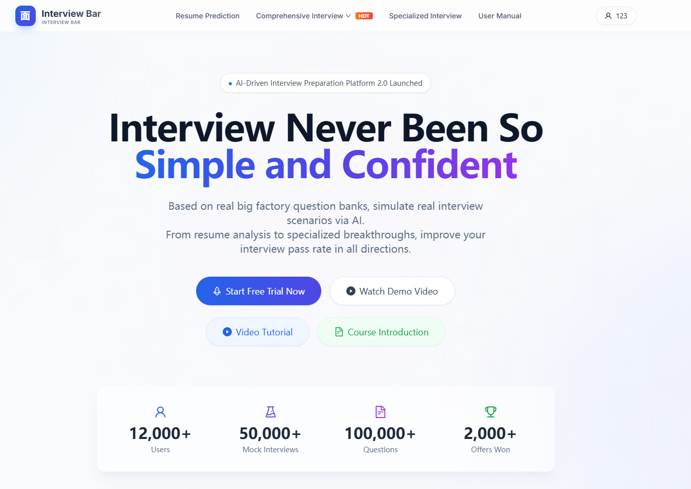
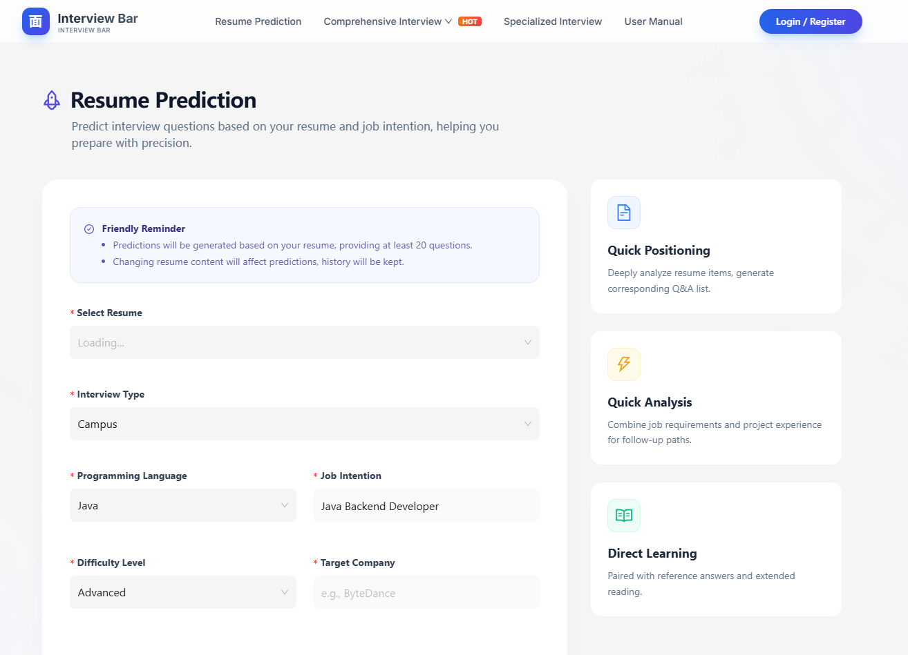
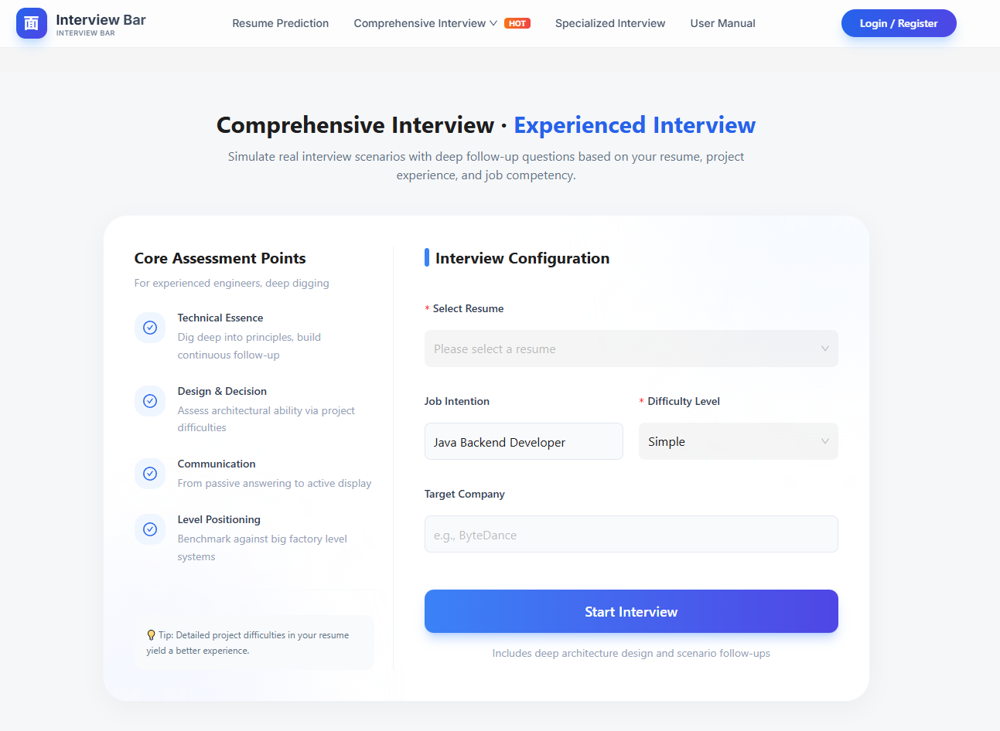
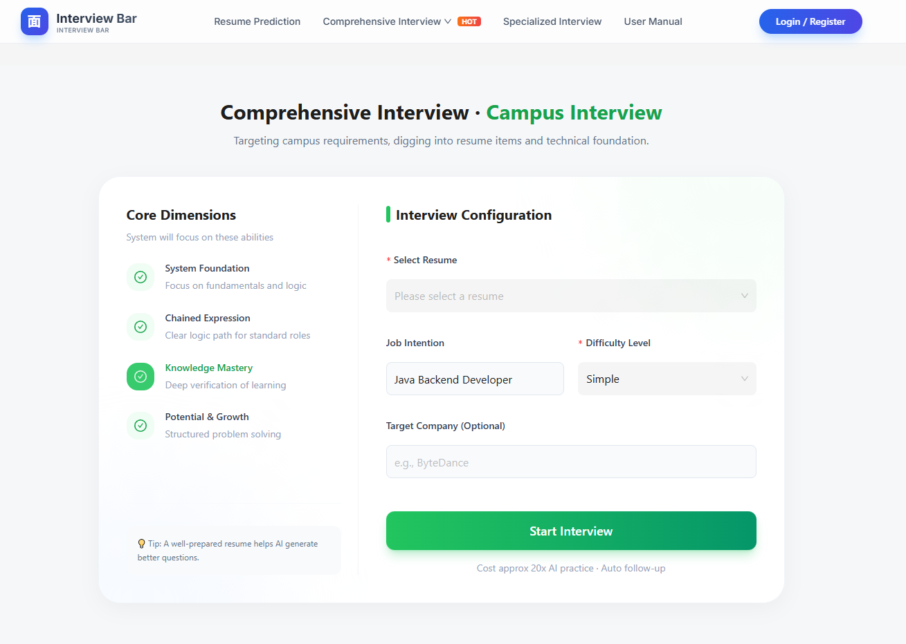
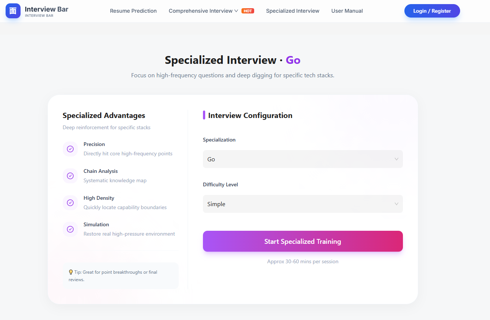
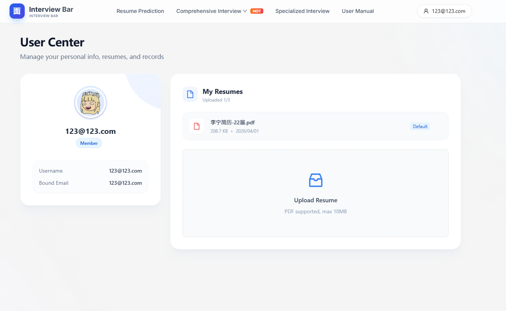
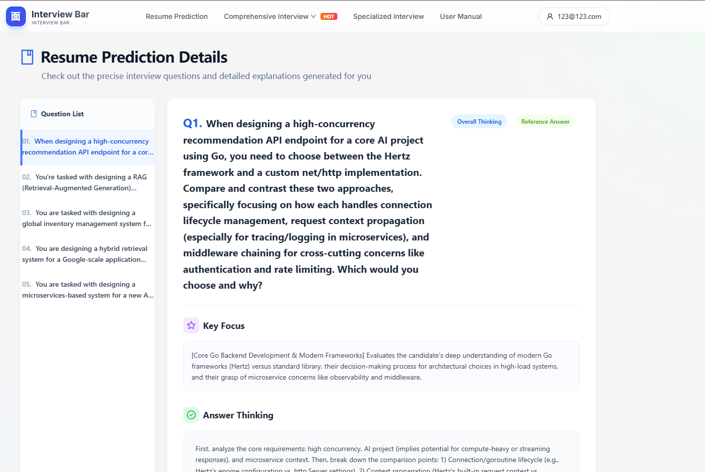
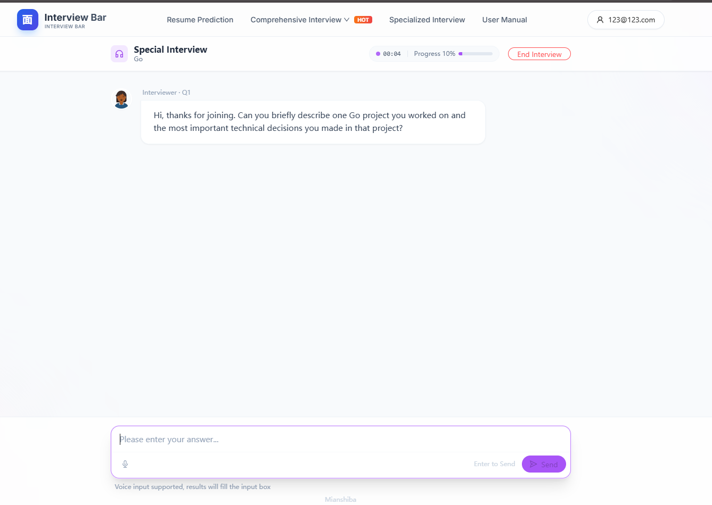
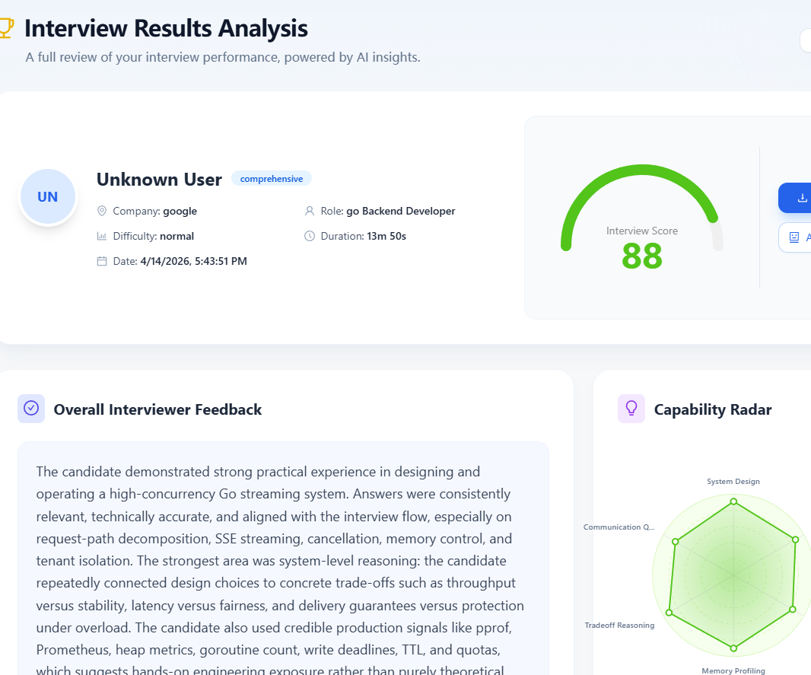

# AI 面试训练平台 | AI Interview Practice Platform

基于 Go、Hertz、Eino 和 Next.js 构建的 AI 面试训练平台。

项目围绕真实求职流程设计：**简历上传 -> AI 预测题 -> 模拟面试 -> 结果评估 -> 针对性复盘**。

---

## 项目概览

平台提供账号管理、简历解析、面试题生成、模拟面试及结果评估功能，覆盖面试准备、练习和复盘流程。

## 功能地图

| 模块 | 功能 |
|---|---|
| 账号与鉴权 | 注册登录、JWT 鉴权、GitHub/Google OAuth、公开路由白名单 |
| 简历系统 | PDF 上传、默认简历设置、异步解析 |
| AI 预测题 | 基于简历和岗位信息生成问题清单与答题思路 |
| 综合面试 | 校招/社招场景配置，按难度、公司和岗位开展面试 |
| 专项面试 | Go、Java、MySQL、Redis 等技术方向的专项训练 |
| 面试进行中 | SSE 实时问答、进度管理、语音输入（ASR） |
| 结果分析 | 分数、能力雷达、文字点评和改进建议 |
| 支付模块 | Stripe/PayPal 接入与 Webhook 回调处理 |
| 工程稳定性 | 限流、熔断、错误恢复、健康检查和容器部署 |

---

## 页面截图与详细功能说明

> 以下截图展示主要页面与业务模块。

### 1) 首页落地页


**功能说明**

- 作为产品入口，展示平台功能和面试训练流程
- 顶部导航直接映射核心业务：简历预测、综合面试、专项面试、用户中心
- 通过统计卡片展示平台概览

---

### 2) 简历预测页（Resume Prediction）


**功能说明**

- 选择简历 + 面试类型 + 编程语言 + 岗位意向 + 难度 + 目标公司
- 系统据此生成个性化预测题，而不是固定题库
- 右侧卡片强调输出价值：定位、分析、学习路径

---

### 3) 综合面试（社招场景）


**功能说明**

- 面向有经验候选人，强调系统设计、项目难点、深度追问
- 左侧展示考察维度，右侧进行面试配置并启动
- 支持按岗位和公司定制问题策略

---

### 4) 综合面试（校招场景）


**功能说明**

- 面向校招候选人，重点关注基础、表达、潜力和成长
- 同样是统一引擎，但呈现不同考察维度与文案策略
- 支持一键开始模拟

---

### 5) 专项面试（以 Go 为例）


**功能说明**

- 按技术栈聚焦高频问题与边界能力（Go/Java/MySQL/Redis 等）
- 支持难度控制，适合突击复习和查漏补缺
- 强调短时高密度训练

---

### 6) 用户中心与简历管理


**功能说明**

- 展示用户资料、已上传简历、默认简历设置
- 支持 PDF 上传（含大小限制）
- 后续预测题与综合面试都依赖默认简历作为输入上下文

---

### 7) 预测题详情页


**功能说明**

- 左侧题目列表，右侧展示题目正文、考察重点、答题思路
- 包含参考答案/思路分层，便于用户复盘
- 结果不是“只给答案”，而是带有可解释结构

---

### 8) 面试进行中（实时交互）


**功能说明**

- 进行中状态包含：题号、进度、计时、结束控制
- 输入区支持文字输入，也支持语音输入转写（ASR）
- 后端提供面向 ASR 的能力探测与转写接口

---

### 9) 面试结果分析页


**功能说明**

- 展示面试得分、能力雷达、综合评语和问题定位
- 可用于复盘学习路径和下一轮训练计划
- 形成“训练闭环”而非一次性问答

---

## 架构详解

### 1. 总体架构

```text
Browser
  -> Nginx Gateway (:81)
      -> Frontend (Next.js 14, React 18)
      -> Backend (Go + Hertz + Eino)
            -> MySQL (业务数据)
            -> Redis (缓存/限流/队列)
            -> Optional: Milvus (向量检索)
            -> Optional: LiteLLM (模型网关)
            -> Optional: CozeLoop (链路观测)
```

### 2. 请求链路（核心路径）

1. 用户在前端页面发起请求（登录、上传简历、开始面试）
2. Nginx 统一转发 API 到后端
3. 后端中间件处理 CORS、JWT、限流、错误恢复
4. 业务服务层调用数据库/缓存/AI 能力
5. 返回结构化响应给前端渲染

### 3. AI 业务链路（以面试为例）

1. 读取用户简历与面试配置
2. 组装提示词与上下文
3. 调用 LLM 生成问题/追问/评估
4. 记录答题过程与指标
5. 生成评分与能力画像

### 4. 实时与稳定性设计

- JWT 鉴权 + 公开路由白名单机制
- 全局错误恢复中间件，避免 panic 直接导致服务中断
- 限流策略支持内存/Redis 两种模式
- Redis Stream 消息队列用于异步任务解耦
- `/health` 健康检查便于容器编排和监控

### 5. ASR 语音能力设计

- 提供 `GET /api/interview/asr/capability`（能力探测）
- 提供 `POST /api/interview/asr/transcribe`（音频转写）
- 支持专用 ASR 配置，缺失即禁用，降低误配置风险
- 带有限流、降级与错误语义化处理

---

## 技术栈

| 层级 | 技术 | 用途 |
|---|---|---|
| 前端 | Next.js、React、TypeScript | 页面路由、组件开发和类型检查 |
| 前端组件与数据 | Ant Design、Zustand、TanStack Query、Axios | 界面组件、状态管理、服务端数据同步和 API 请求 |
| 后端 | Go、Hertz | HTTP API 和业务服务 |
| AI 编排 | Eino | 模型调用、智能体编排和评估流程 |
| 数据库 | MySQL、GORM | 业务数据持久化 |
| 缓存与队列 | Redis | 缓存、限流和 Stream 异步任务 |
| 向量检索（可选） | Milvus | 向量存储与检索 |
| 模型网关（可选） | LiteLLM | 模型接口统一与调用统计 |
| 链路观测（可选） | CozeLoop | AI 调用链路追踪 |
| 支付 | Stripe、PayPal | 支付渠道与回调接入 |
| 登录 | GitHub OAuth、Google OAuth | 第三方账号登录 |
| 部署 | Docker、Compose、Nginx | 容器编排与反向代理 |

---

## 快速启动（推荐 Docker）

### 1) 准备环境

- Docker Desktop（Windows/macOS）或 Docker Engine（Linux）
- Git

### 2) 克隆项目

```bash
git clone https://gitee.com/tao355667/ai-interview-platform.git
cd ai-interview-platform
```

### 3) 配置环境变量

```bash
cp .env.example .env
```

按照 `.env` 注释填写配置。项目中所有真实密钥已移除，均为安全占位符说明。

### 4) 一键启动

```bash
docker-compose up -d
```

### 5) 访问

- 网关入口：`http://localhost:81`
- 前端：`http://localhost:3000`
- 后端：`http://localhost:8899`
- 健康检查：`http://localhost:8899/health`

---

## 本地开发模式（分开调试）

### 启动依赖服务

```bash
docker-compose up -d mysql redis
```

### 启动后端

```bash
cd backend
go run ./cmd/server/main.go
```

### 启动前端

```bash
cd frontend
npm install
npm run dev
```

---

## 核心目录结构

```text
backend/
  cmd/server/                  # 后端入口
  api/                         # 路由与 Handler
  internal/service/            # 核心业务服务
  internal/agents/             # AI 代理与评估逻辑
  internal/middleware/         # JWT、限流等中间件

frontend/
  src/app/                     # 页面路由
  src/components/              # 组件
  src/services/                # API 客户端与请求封装

xiangmu-image/                 # README 展示截图
```

---

## License

项目的使用、修改和分发条款详见 [LICENSE](./LICENSE)。
